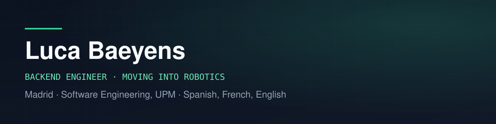

<div align="center">
  
</div>

## About

Software engineering student at UPM (ETSISI) in Madrid. I build backends: APIs, data models, authentication, integrations and deployment. I also teach Python and C to university students.

Moving into robotics from the software side: simulation, perception and control.

## Projects

### [Studyist](https://github.com/lucabae/studyist)

Local-first study workspace. FastAPI, SQLite with FTS5, JWT auth, CalDAV sync with iCloud, spaced-repetition flashcards and LLM-generated exercises. Includes a pytest suite.

### [KitchenManager](https://github.com/lucabae/KitchenManager)

Kitchen inventory with barcode scanning. React 19 + TypeScript frontend, Flask API, SQLite, Open Food Facts integration.

### [Moodle-scraper](https://github.com/lucabae/Moodle-scraper)

CLI that mirrors a Moodle course as a local folder tree. Python, Selenium and BeautifulSoup. Fork of NelBruh/Moodle-scraper, MIT.

## Stack

```text
Backend    Python · FastAPI · Django · Flask · REST · JWT · SQLite · PostgreSQL
Frontend   React · TypeScript · Tailwind CSS
Infra      Docker · Linux · Cloudflare · VPS
Tools      Git · pytest · Selenium
```

## Links

- Portfolio: [lucabae.com](https://lucabae.com)
- Email: [me@lucabae.com](mailto:me@lucabae.com)
- LinkedIn: [luca-b-75ba15269](https://www.linkedin.com/in/luca-b-75ba15269/)
